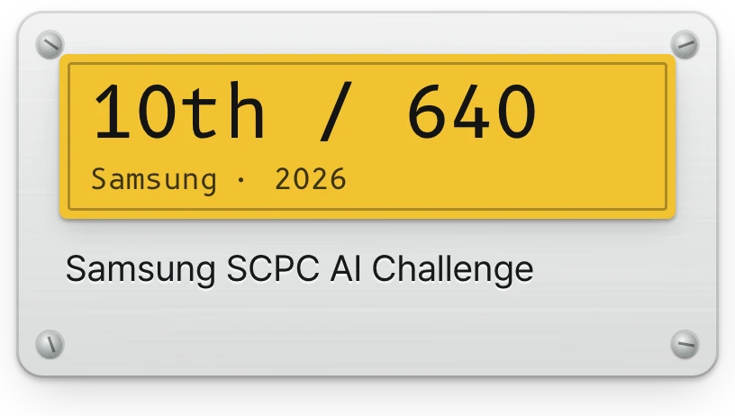
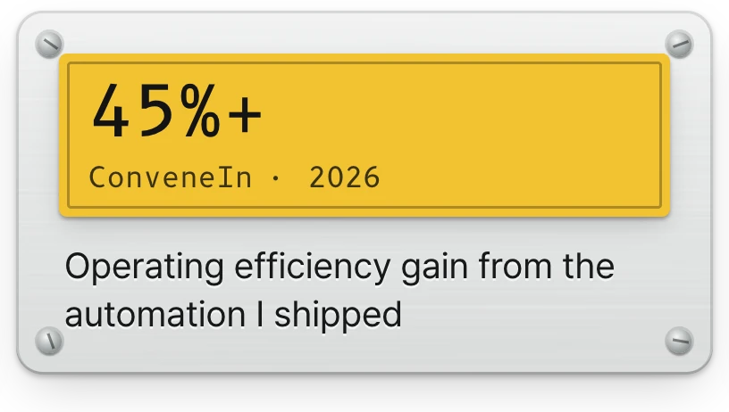
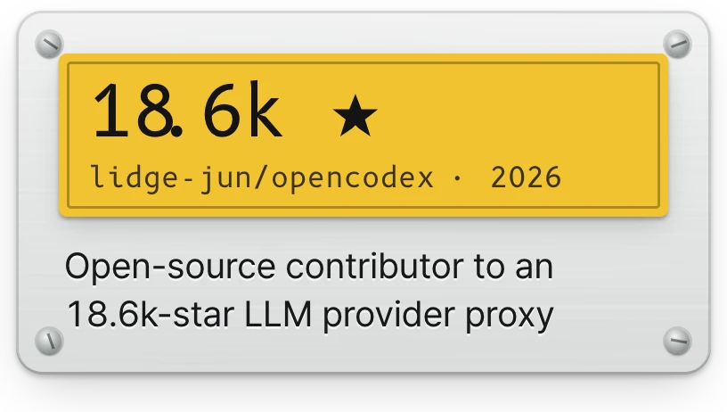
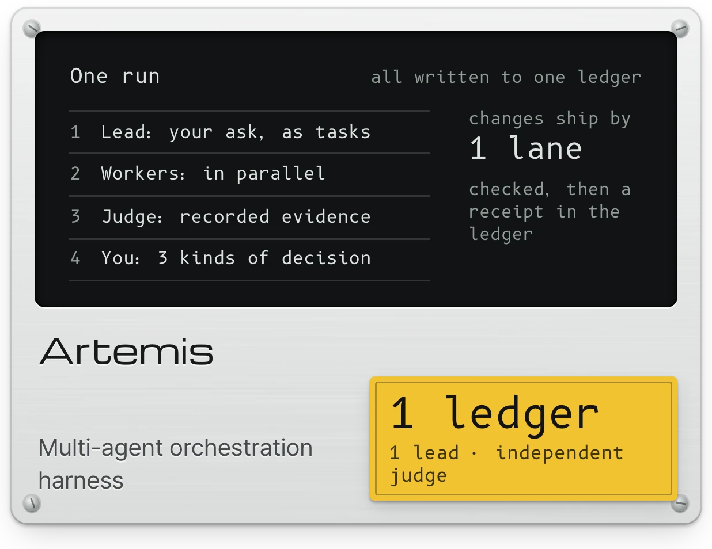
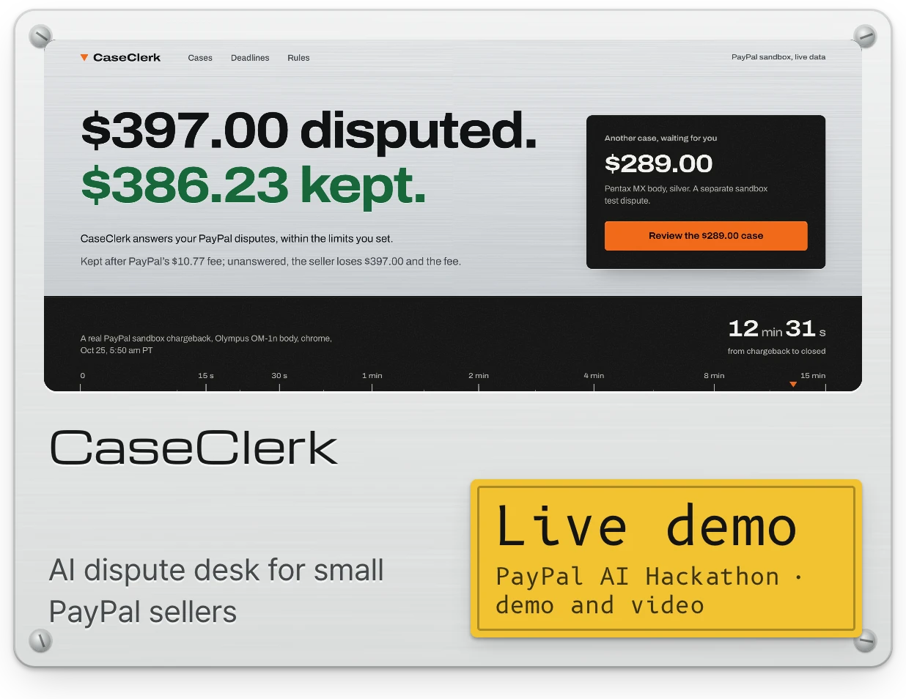
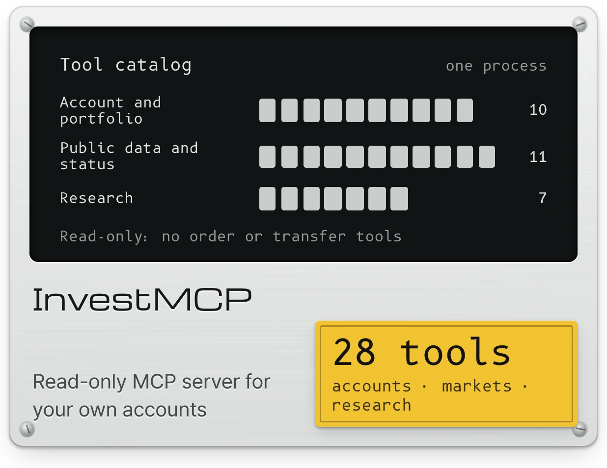
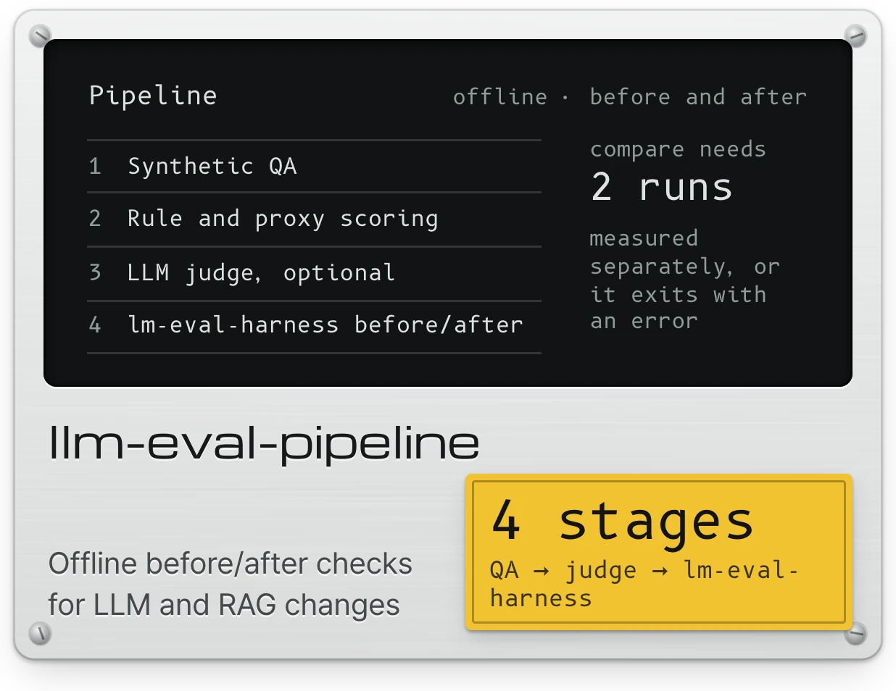
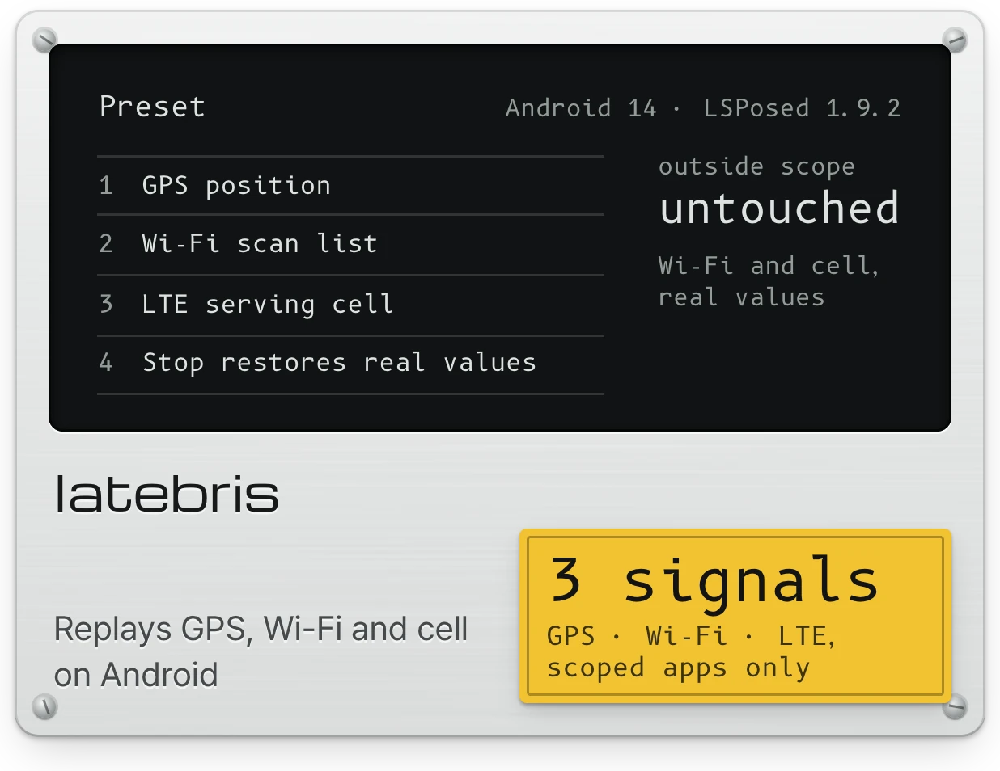
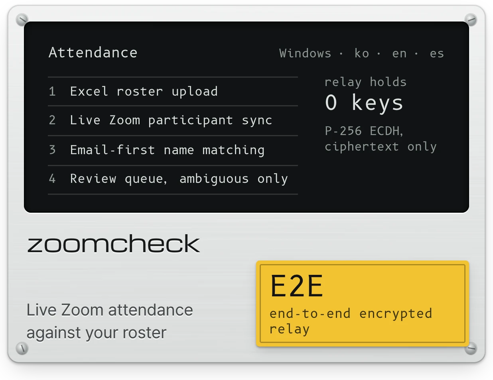

I build AI agent systems end to end. 

<a href="https://dacon.io/competitions/official/236730/codeshare/14188"><picture><source media="(prefers-color-scheme: dark)" srcset="assets/stat-scpc.dark.webp"></picture></a>
<picture><source media="(prefers-color-scheme: dark)" srcset="assets/stat-convenein.dark.webp"></picture>
<a href="https://github.com/lidge-jun/opencodex/pull/3403"><picture><source media="(prefers-color-scheme: dark)" srcset="assets/stat-opencodex.dark.webp"></picture></a>

<a href="https://github.com/ianlyoo/artemis"><picture><source media="(prefers-color-scheme: dark)" srcset="assets/card-artemis.dark.webp"></picture></a>
<a href="https://caseclerk.vercel.app"><picture><source media="(prefers-color-scheme: dark)" srcset="assets/card-caseclerk.dark.webp"></picture></a>
<a href="https://github.com/ianlyoo/investmcp"><picture><source media="(prefers-color-scheme: dark)" srcset="assets/card-investmcp.dark.webp"></picture></a>
<a href="https://ianlyoo.github.io/llm-eval-pipeline/"><picture><source media="(prefers-color-scheme: dark)" srcset="assets/card-llmeval.dark.webp"></picture></a>
<a href="https://github.com/ianlyoo/latebris"><picture><source media="(prefers-color-scheme: dark)" srcset="assets/card-latebris.dark.webp"></picture></a>
<a href="https://github.com/ianlyoo/zoomcheck"><picture><source media="(prefers-color-scheme: dark)" srcset="assets/card-zoomcheck.dark.webp"></picture></a>

## Projects

- **[Artemis](https://github.com/ianlyoo/artemis)**: a self-hosted home for AI agents running on your own computer or an always-on server. From a browser on a PC, Mac or phone, you chat with one lead, answer approval and secret cards, and read the boards it writes while coding agents work side by side and a separate judge checks each result. Money out, irreversible deletes and anything sent as you wait for your yes, and rejected results become lessons that change the next run. [v0.4.0](https://github.com/ianlyoo/artemis/releases/tag/v0.4.0) · local demo without an account: `artemis demo`.
- **[CaseClerk](https://github.com/ianlyoo/caseclerk)**: an AI agent that resolves PayPal disputes for small sellers. It reads each dispute, files evidence through PayPal's Disputes API, answers small cases before the deadline on its own, and escalates anything over the seller's limits. Built for the PayPal AI Hackathon. [Live demo](https://caseclerk.vercel.app) · [Video](https://youtu.be/Z-NBssV4bSk)
- **[InvestMCP](https://github.com/ianlyoo/investmcp)**: a read-only MCP server that lets an AI assistant (any MCP client) answer questions about your own brokerage and crypto-futures accounts next to public market data and ticker research. It unifies my two earlier servers into one process, one tool catalogue and one auth boundary: 28 tools.
- **[llm-eval-pipeline](https://github.com/ianlyoo/llm-eval-pipeline)**: a before/after evaluation pipeline for LLM and RAG changes: synthetic QA, rule and proxy scoring, an optional LLM judge and lm-eval-harness. It refuses to report an improvement that was not measured. [Project page](https://ianlyoo.github.io/llm-eval-pipeline/)
- **[latebris](https://github.com/ianlyoo/latebris)**: an Android app that plays back a saved location environment: a GPS position, a Wi-Fi scan and LTE cells. On a stock phone it moves GPS through Android's mock location; with Magisk and LSPosed it serves all three only inside the apps you choose, and every other app keeps its real Wi-Fi and cell data. Verified on Android 14 and 15 emulators with a separate probe app, and the repository says what it does not cover and how a defender can detect it.
- **[zoomcheck](https://github.com/ianlyoo/zoomcheck)**: a Windows app that matches an Excel roster against a live Zoom meeting and sends only the ambiguous names to review. Dashboard in Korean, English and Spanish, a self-contained installer with verified auto-update, and an end-to-end encrypted relay for Zoom Pro: P-256 ECDH and AES-256-GCM, so the relay only ever sees ciphertext. [Project page](https://ianlyoo.github.io/zoomcheck/)

More work

- **[rag-ops-console](https://github.com/ianlyoo/rag-ops-console)**: a self-correcting RAG console, the online half of llm-eval-pipeline: it grades retrieval and rewrites the query when retrieval misses. [Project page](https://ianlyoo.github.io/rag-ops-console/)
- **[K-invest](https://github.com/ianlyoo/K-invest)**: read-only portfolio data from 8 sources; every number carries its source and as-of time. [Project page](https://ianlyoo.github.io/K-invest/)
- **[ticker-research-mcp](https://github.com/ianlyoo/ticker-research-mcp)**: researches one stock at a time from SEC filings and daily prices, with about 40 factors whose calculation is shown, each labelled with source and date.
- **[signal-foundry](https://github.com/ianlyoo/signal-foundry)**: a stock screener that ranks fundamentals the same way every run and writes a PDF research packet for each pick. [Project page](https://ianlyoo.github.io/signal-foundry/)
- **[GeminiContextPack](https://github.com/ianlyoo/GeminiContextPack)**: packs long text as a native PDF so the model counts fewer input tokens. [Project page](https://ianlyoo.github.io/GeminiContextPack/)
- **[SameTaste](https://github.com/ianlyoo/sametaste)**: paste a month of card spending; an agent finds each merchant on Qloo's taste graph and suggests a cheaper place with the same taste, and re-plans any line you refuse. [Demo](https://qloo-sametaste.vercel.app)
- **[Calydon](https://github.com/ianlyoo/calydon)**: a memecoin you hunt together on NEAR testnet. NEAR Build Beyond Boundaries entry (judging in progress). [Live demo](https://ianlyoo.github.io/calydon/) · [Status page](https://ianlyoo.github.io/calydon/status/)
- **[koreainv-dashboard](https://github.com/ianlyoo/koreainv-dashboard)**: Korea Investment & Securities account dashboard for desktop, web and Android. [Project page](https://ianlyoo.github.io/koreainv-dashboard/)
- **[Removing the Human Bottleneck Without Losing Authorship?](https://github.com/ianlyoo/authorisation-evidence-audit)**

## Work

- **ConveneIn Co., Ltd.** · Cloud Automation Engineer (contract) · Jul – Aug 2026. Automated invitations, scheduling and lodging for hundreds of faculty at a medical conference. In production, one person now runs coordination that several staff used to split, and the department's operating efficiency rose 45%+.
- **Freelance** · AI Workflow Automation Engineer for SMEs and a medical society · Mar 2025 – present. Automated 5+ core SME workflows and built a lightweight ERP-style internal system. For the medical society, designed a privacy-preserving pipeline where a local LLM masks patient data before a commercial LLM analyzes it, unblocking a stalled project.

## Contests

- **Samsung Collegiate Programming Challenge (SCPC), AI Challenge** · 2026: 10th of 640. [Write-up](https://dacon.io/competitions/official/236730/codeshare/14188)
- **National AI Competitions** · 2026, solo: [dashcam accident analysis](https://github.com/ianlyoo/dashcam-accident-understanding) and [deepfake-voice detection](https://github.com/ianlyoo/multidomain-deepfake-audio-detection).
- **PayPal AI Hackathon** · 2026: CaseClerk.

## Open source

- Contributor to [lidge-jun/opencodex](https://github.com/lidge-jun/opencodex) (18.6k★), a universal LLM provider proxy: [tool-name namespace handling in the proxy](https://github.com/lidge-jun/opencodex/pull/3403).

## Stack

Python · TypeScript · Rust (NEAR contracts) · MCP servers · LangGraph · RAGAS · Chroma · lm-eval-harness · PyTorch · Next.js · SQLite · GitHub Actions

한국어

**유영인 (Youngin Lyoo)** · LLM 평가·AI 에이전트 엔지니어 · 서울

**한눈에**
- 삼성 SCPC AI 챌린지 10위 / 640명 (2026)
- 컨빈인에서 직접 만든 자동화로 부서 운영 효율 45% 이상 개선
- 별 1.86만 개 오픈소스 LLM 프록시 lidge-jun/opencodex 기여자

**프로젝트**
- **Artemis**: 내 컴퓨터나 늘 켜 둔 서버에서 돌리는 AI 에이전트의 집입니다. PC·맥·폰 브라우저에서 리드 한 명과 대화하고, 승인·비밀값 카드에 답하고, 리드가 쓴 보드를 읽는 동안 여러 AI 코딩 에이전트가 나란히 일하고, 작업자가 아닌 판정자가 결과를 확인합니다. 돈이 나가는 일, 되돌릴 수 없는 삭제, 나 대신 보내는 일은 내 답을 기다리고, 판정에서 떨어진 결과는 다음 작업을 바꾸는 교훈이 됩니다. [v0.4.0](https://github.com/ianlyoo/artemis/releases/tag/v0.4.0) · 계정 없이 도는 로컬 데모: `artemis demo`.
- **CaseClerk**: 소규모 PayPal 판매자의 분쟁을 처리하는 AI 에이전트입니다. 분쟁을 읽고 PayPal Disputes API로 증거를 내며, 작은 분쟁은 기한 안에 스스로 답하고 판매자가 정한 선을 넘는 분쟁은 판매자에게 올립니다. PayPal AI Hackathon 출품작입니다.
- **InvestMCP**: MCP를 쓰는 AI 어시스턴트가 내 증권·크립토 선물 계좌와 공개 시장 데이터, 종목 리서치를 함께 보고 답하게 해 주는 읽기 전용 MCP 서버입니다. 앞서 만든 서버 두 개를 하나로 합쳐 도구 28개를 한 프로세스, 한 인증 경계 안에 넣었습니다.
- **llm-eval-pipeline**: LLM·RAG 변경 전후를 평가하는 파이프라인입니다. 합성 QA, 규칙·프록시 채점, LLM 판정, lm-eval-harness까지 이어지고, 측정하지 않은 개선은 보고하지 않습니다.
- **latebris**: 저장해 둔 위치 환경(GPS 좌표, Wi-Fi 스캔, LTE 기지국)을 재생하는 안드로이드 앱입니다. 일반 폰에서는 안드로이드 모의 위치로 GPS를 바꾸고, Magisk와 LSPosed가 있으면 고른 앱 안에서만 세 신호를 모두 바꿉니다. 다른 앱에는 실제 Wi-Fi와 기지국 값이 그대로 보입니다. Android 14·15 에뮬레이터에서 별도 프로브 앱으로 검증했고, 다루지 않는 부분과 방어하는 쪽의 탐지 방법도 저장소에 적어 두었습니다.
- **zoomcheck**: 엑셀 명단과 진행 중인 Zoom 회의 참가자를 맞춰 보고, 애매한 이름만 검토로 보내는 윈도우 앱입니다. 한국어·영어·스페인어 대시보드, 검증된 자동 업데이트가 붙은 설치본, Zoom Pro용 종단 간 암호화 릴레이(P-256 ECDH, AES-256-GCM)를 갖췄고, 릴레이는 암호문만 봅니다.

**경력**
- **(주)컨빈인 ConveneIn** · 클라우드 자동화 엔지니어(계약직) · 2026.07 – 2026.08. 의학 컨퍼런스 교수 수백 명의 초청·일정·숙박 연락을 자동화했습니다. 실제 운영에서 여러 명이 나누던 조율을 한 사람이 맡게 되었고, 부서 운영 효율이 45% 이상 좋아졌습니다.
- **프리랜서** · AI/AX 워크플로우 자동화 엔지니어, 중소기업·의학회 · 2025.03 – 현재. 중소기업 핵심 업무 5개 이상을 자동화하고 경량 ERP형 내부 시스템을 만들었습니다. 의학회에는 로컬 LLM이 환자 데이터를 먼저 가린 뒤 상용 LLM이 분석하는 개인정보 보호 파이프라인을 설계해, 멈춰 있던 프로젝트를 다시 움직였습니다.

**대회**
- **삼성전자 대학생 프로그래밍 챌린지(SCPC) AI 챌린지** · 2026: 10위 / 640명
- **국가 AI 경진대회** (행정안전부·국과수·NIA 주최) · 2026, 개인 참가: 블랙박스 영상 고의사고 분석, 딥보이스 탐지
- **PayPal AI Hackathon** · 2026: CaseClerk

[LinkedIn](https://www.linkedin.com/in/younginlyoo/)
